# adc-dma —— ADC 多通道 + DMA 循环采集 + 滑动平均滤波

> 难度：★★★☆　｜　涉及外设：ADC + DMA　｜　对应章节：[15 ADC 与 DAC 采样](../../docs/v1-drivers/15-adc-dac-sampling.md) / [14 DMA](../../docs/v1-drivers/14-dma.md)

<p align="center">
  
  <br><sub>▲ 动画：ADC 采样保持 + 逐次逼近（SAR）比较过程（作者自绘矢量图）</sub>
</p>

`hardware_status: pending`。本目录是 **BluePill / STM32F103C8T6 的完整 CMake 工程**：固定 STM32CubeF1 `v1.8.6`、HAL/CMSIS 子模块提交、启动文件、64 KiB Flash / 20 KiB RAM 链接脚本、SysTick 时基和许可复制。固件构建、实际 ELF/BIN 向量与内存检查、宿主回归均通过；ADC 实际读数、DMA 传输波形与滑动平均的板上效果仍未实测。

## 一、功能说明

用 ADC1 扫描 **3 个通道**（PA0/PA1/PA4），**连续转换 + DMA 循环搬运**，CPU 完全不参与采样：

- 每 100ms 求一次每通道的**块平均**（16 点），再对块平均做**滑动平均**（窗口 8）低通滤波；
- 按 `V = ADC_Code × Vref / 4096`（Vref=3.3V）换算电压；
- 板载 LED 每处理一次翻转，作为心跳。

## 二、硬件接线表

| 开发板 | 外设 | 引脚 | 接法 | 备注 |
| --- | --- | --- | --- | --- |
| BluePill | 电位器 / 传感器 1 | PA0 (ADC1_IN0) | 中点接 PA0，两端接 3.3V/GND | 分压测电压 |
| BluePill | 传感器 2 | PA1 (ADC1_IN1) | 信号接 PA1 | — |
| BluePill | 传感器 3 | PA4 (ADC1_IN4) | 信号接 PA4 | 与 SPI1_NSS 复用，注意冲突 |
| BluePill | LED | PC13 | 板上已接 | 心跳指示 |

> **PA4 与 SPI1_NSS 复用**：若同时用 SPI1 片选，改用其它 ADC 通道（如 PA2/PA3=CH2/CH3）。

## 三、CubeMX 关键配置

| 配置项 | 取值 | 说明 |
| --- | --- | --- |
| ADC1 → Scan Mode | Enabled | 多通道扫描 |
| ADC1 → Continuous Conversion | Enabled | 连续转换 |
| ADC1 → Number of Conversions | 3 | 规则组 3 个 |
| ADC1 → Rank 1/2/3 | CH0 / CH1 / CH4 | 转换顺序 |
| ADC1 → Sampling Time | 55.5 cycles | 高阻源要加长 |
| ADC1 → DMA Continuous Requests | Enabled | 每次转换都请求 DMA |
| DMA | ADC1 → DMA1 Channel1, **Circular** | 循环模式 |
| ADC 时钟 | PCLK2/6 = 12MHz | ≤14MHz |
| GPIO | PA0/PA1/PA4 → Analog | 必须模拟模式 |

## 四、关键代码解读

**1) 扫描 + 连续 + DMA 循环（一次配置，后台自动跑）**

```c
hadc1.Init.ScanConvMode       = ADC_SCAN_ENABLE;
hadc1.Init.ContinuousConvMode = ENABLE;
hadc1.Init.NbrOfConversion    = ADC_NUM_CH;      /* 3 */
/* DMA 用循环模式，数组自动回卷形成环形缓冲 */
hdma_adc1.Init.Mode = DMA_CIRCULAR;
HAL_ADC_Start_DMA(&hadc1, (uint32_t *)g_adc_buf, ADC_BUF_SIZE);
```

**2) DMA 缓冲区布局（按转换顺序交错）**

```text
下标: 0    1    2    3    4    5   ...
通道: CH0  CH1  CH4  CH0  CH1  CH4 ...
```

因此通道 `ch` 的数据在下标 `ch, ch+3, ch+6, ...`：

```c
static uint32_t adc_channel_avg(uint8_t ch) {
    uint32_t sum = 0;
    for (int s = 0; s < ADC_SAMPLES; s++) sum += g_adc_buf[s*ADC_NUM_CH + ch];
    return sum / ADC_SAMPLES;
}
```

**3) 滑动平均滤波（低通，抑制噪声）**

```c
static float moving_average(uint8_t ch, float v) {
    g_ma_buf[ch][g_ma_idx] = v;                 /* 写入窗口 */
    /* 求窗口内平均，返回滤波结果 */
    ...
}
```

窗口越大越平滑但响应越慢——采样率与噪声权衡。

**4) 电压换算**

```c
V = (float)code * 3.3f / 4096.0f;   /* 12 位：2^12 = 4096 */
/* 1 LSB ≈ 3.3V/4096 ≈ 0.806 mV */
```

## 五、编译、检查与烧录

需 Git、CMake ≥3.21、Ninja、GNU Arm 工具链（含 newlib）；下载另需 OpenOCD。本机验证版本为 GCC 10.3.1、CMake 3.30.2、Ninja 1.12.1。

以下从**仓库根目录**执行。已有相同提交的 CubeF1 可直接传路径：

```console
git clone --depth 1 --branch v1.8.6 https://github.com/STMicroelectronics/STM32CubeF1.git .temp/STM32CubeF1
git -C .temp/STM32CubeF1 submodule update --init Drivers/STM32F1xx_HAL_Driver Drivers/CMSIS/Device/ST/STM32F1xx
cd examples/adc-dma
cmake --preset bluepill "-DCUBEF1_PATH=../../.temp/STM32CubeF1"
cmake --build --preset bluepill
python tests/check_firmware.py build/bluepill/adc-dma.elf build/bluepill/adc-dma.bin
```

`build/bluepill/` 中应有 `adc-dma.elf/.hex/.bin/.map`。检查器读取真实二进制，核对栈顶、复位入口、SysTick 向量、`hadc1`/`hdma_adc1` 的存储、`g_adc_buf`（96 B，半字对齐）与 `g_ma_buf`（96 B）的 .bss 位置、`g_ma_idx`/`g_ma_filled` 的字节宽度和至少 2 KiB 栈预留。提交不符或子模块未初始化时 CMake 直接失败。

2026-11-26 本机快照：

| 产物 | 结果 |
| --- | --- |
| BIN | 9980 B；SHA-256 `4290ca392d965bfac3aa009b95dfd909d0cdbe7b2e1af4b670dea832706d97c6` |
| ELF | SHA-256 `3ef7fcb58f0e3d60f0da9eacd9060d51d7ed20fc55683b72ee15fff669a44bd9` |
| Flash | 9980 B / 64 KiB |
| 静态 RAM | 328 B / 20 KiB |
| 栈预留 | 2048 B；总计 2376 B / 20 KiB |

换工具链后以新日志和哈希为准。CI 用的是 Ubuntu 仓库版 `arm-none-eabi-gcc`，同一份源码编出 **10132 B** Flash、RAM 仍是 2376 B，复位入口 `0x8000591`、SysTick `0x8000577`（本机 10.3.1 分别为 `0x800058d`、`0x8000575`）。`tests/check_firmware.py` 只校验栈顶、向量落点、段归属、对齐与字节宽度，不比对绝对地址或哈希。

宿主回归：

```console
cmake --preset host-tests
cmake --build --preset host-tests
ctest --preset host-tests
```

测试把生产 `main.c` 连同 `adc_dma_init`、`adc_channel_avg`、`adc_to_volt`、`moving_average` 和主循环一起编译，用受控 HAL 替身覆盖：上电时钟链（HSE → PLL ×9、APB1 /2、ADC 时钟 /6）、LED 与三个模拟引脚配置、DMA1_CH1 的循环/半字/外设到内存/优先级、ADC 扫描 + 连续 + 右对齐 + 3 个转换、三个 rank 的通道与采样时间、校准位于 rank 配置之后且 `HAL_ADC_Start_DMA` 之前、`Start_DMA` 的缓冲区与长度、交错缓冲的通道去平均、电压换算、滑动平均窗口填满与滑出、100 ms 心跳边界（99 ms 不翻转、100 ms 翻转、199 ms 不翻转、200 ms 翻转）、一个处理周期只推进一次窗口、失败路径在 `Start_DMA` 之前终止。它只证明生产控制流与算式，不证明真实 ADC 时序、DMA 波形或板上读数。

编译成功后，核对 BOOT0=0、PA13/PA14 保留 SWD、PA0/PA1/PA4 的信号源与共地，再执行下载：

```console
openocd -f interface/stlink.cfg -f target/stm32f1x.cfg -c "program build/bluepill/adc-dma.elf verify reset exit"
```

保存含 `verify` 成功的完整日志，再记录实际读数。本轮未执行下载或上板观测。Wokwi 配置指向 `build/bluepill/adc-dma.elf`；Wokwi 的 ADC 模型不覆盖真实模拟前端，不作为验收依据。

仍要用 CubeMX/Keil/CubeIDE 时：把本 `main.c` 覆盖 `Core/Src/main.c`，保留生成的 `stm32f1xx_it.c` 中 `SysTick_Handler`，删除生成的 `MX_ADC1_Init`/`MX_DMA_Init` 以免重复配置。

## 六、预期现象（理论与设计目标，未实测）

- 转动接 PA0 的电位器，对应通道读到的电压随之变化（0~3.3V）；
- 板载 LED 约 5Hz 闪烁（每 100 ms 处理一次）；
- 滑动平均后读数比原始值更平稳（抖动更小）；
- **块平均不是原子快照**：DMA 在循环模式下持续覆写同一块缓冲区，`adc_channel_avg()` 读取期间可能跨过两个缓冲区周期。一个周期约 48 × (55.5 + 12.5) / 12 MHz ≈ 272 µs，CPU 读完 48 个半字远快于此，但示例不承诺抗撕裂；需要严格一致时改用双缓冲或半传输/传输完成回调；
- 每个处理周期取的是「最近 48 个样本」的窗口，不是与某一时刻严格同步的快照；
- `error_handler()` 是终止点：时钟、DMA、ADC 初始化或 `HAL_ADC_Start_DMA` 失败时关中断原地停留，LED 不再翻转。它不是可恢复路径；
- 后续取证记录原始 ADC 码值与板上电压表读数，不以一次快照宣称精度达标。

## 七、常见问题

| 现象 | 原因 | 解决 |
| --- | --- | --- |
| 读数一直是 0 | 引脚没配成 Analog / 没接信号 | GPIO 设 `GPIO_MODE_ANALOG` |
| 读数一直是 4095 | 引脚接 3.3V / 悬空上拉 | 检查接线 |
| 读数抖动大 | 采样时间太短 / 源阻抗高 | 加大采样时间，加滑动平均 |
| 通道数据错位 | 缓冲区布局理解错 | 按 `s*3+ch` 取通道数据 |
| 只采了一次 | DMA 配成 Normal | 改 `DMA_CIRCULAR` |
| 精度差 | VDDA 不是精确 3.3V | 测 Vrefint 反推真实 VDDA |
| ADCCLK 超 14MHz | 预分频不对 | 用 `/6` 或 `/8` |

## 八、相关资源

- 参考手册 **RM0008** 第 11 章（ADC，含 SQR/SMPR/CR2 位说明）、第 10 章（DMA 映射表）
- 数据手册 **DS5319**（ADC 通道与引脚、VDDA 范围）
- 相关图：[`assets/animations/adc-sar.svg`](../../assets/animations/adc-sar.svg)、[`assets/gif/sar-adc.gif`](../../assets/gif/sar-adc.gif)、[`assets/animations/dma-circular.svg`](../../assets/animations/dma-circular.svg)
- 免责声明：本示例配图为作者自绘矢量图/程序生成动画，非厂商实拍照片。
