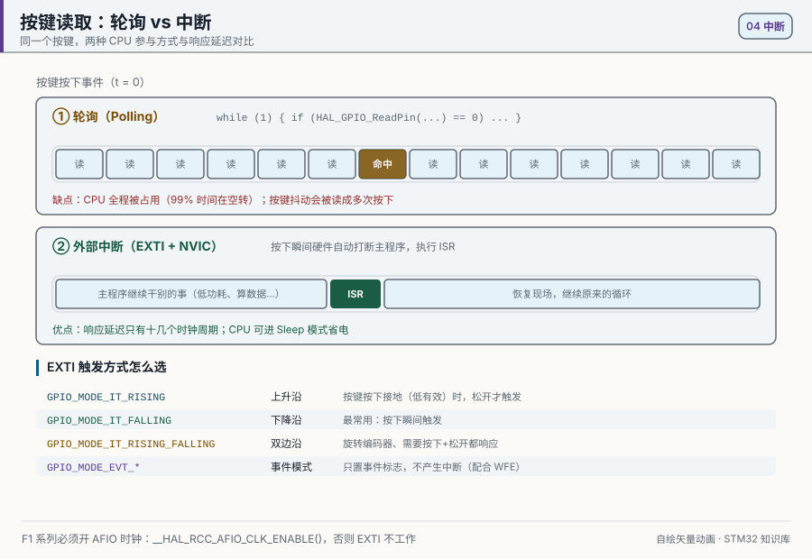

# exti-key —— EXTI 外部中断按键

> 难度：★★☆☆　｜　涉及外设：GPIO + EXTI + NVIC　｜　对应章节：[第10章中断与NVIC/EXTI](../../docs/v1-drivers/10-interrupts-nvic-exti.md)

<p align="center">
  
  <br><sub>▲ 动画：轮询 vs 外部中断 vs EXTI 触发方式对比（作者自绘矢量图）</sub>
</p>

`hardware_status: pending`。本目录是 **BluePill / STM32F103C8T6 的完整 CMake 工程**：固定 STM32CubeF1 `v1.8.6`、HAL/CMSIS 子模块提交、启动文件、64 KiB Flash / 20 KiB RAM 链接脚本、SysTick 时基、EXTI0 向量入口和许可复制。固件构建、实际 ELF/BIN 向量与内存检查、宿主回归均通过；下载、真实按键波形、抖动表现与一次按压只产生一个事件的承诺仍未实测。

## 一、功能说明

用 PA0 按键的**下降沿中断**翻转板载 LED(PC13)，演示中断编程的标准范式：

- **两级结构**：ISR 只置 `volatile` 标志，耗时处理放主循环；
- **软件消抖**：主循环延时 20ms 后确认电平仍为低，才认为是有效按键；
- **回调写法**：用 HAL 的 `HAL_GPIO_EXTI_Callback`，而不是在 `EXTI0_IRQHandler` 里直接写逻辑；
- **NVIC 优先级**：`HAL_NVIC_SetPriority` 设置抢占/子优先级。

## 二、硬件接线表

| 开发板 | 外设 | 引脚 | 接法 | 备注 |
| --- | --- | --- | --- | --- |
| BluePill | 按键 | PA0 | 一端接 PA0，另一端接 GND | 内部上拉，**按下为低** |
| BluePill | LED | PC13 | 板上已接 | 低电平点亮 |

> 无外部按键时，可用杜邦线把 PA0 瞬时接到 GND 模拟一次按下。

## 三、CubeMX 关键配置

| 配置项 | 取值 | 说明 |
| --- | --- | --- |
| GPIO PA0 | GPIO_EXTI0 / **Pull-up** / External Interrupt Mode with Falling edge | 下降沿触发 |
| NVIC | EXTI line0 interrupt → Enabled | 抢占 1，子优先级 0 |
| NVIC Priority Group | 4 bits for pre-emption（默认） | HAL 默认分组 |
| RCC → HSE | Crystal/Ceramic Resonator | 8MHz 晶振 |
| SYS → Debug | Serial Wire | 保留 SWD |

> **F1 特有坑**：`HAL_GPIO_Init` 配置 EXTI 模式时会自动使能 AFIO 时钟，但若你手动写寄存器映射，务必 `__HAL_RCC_AFIO_CLK_ENABLE()`。

## 四、关键代码解读

**1) 把引脚配成「中断模式」**

```c
io.Pin  = KEY_PIN;
io.Mode = GPIO_MODE_IT_FALLING;   /* 下降沿中断；另有 _RISING / _RISING_FALLING */
io.Pull = GPIO_PULLUP;            /* 平时为高，按下接地为低 */
HAL_GPIO_Init(KEY_PORT, &io);
```

**2) NVIC 优先级设置**

```c
HAL_NVIC_SetPriority(EXTI0_IRQn, 1, 0);   /* 抢占=1，子优先级=0，数值越小越优先 */
HAL_NVIC_EnableIRQ(EXTI0_IRQn);           /* 使能该中断线，否则永远进不去 */
```

**3) 中断服务函数 + 回调（两级结构）**

```c
void EXTI0_IRQHandler(void)                 /* 向量：PA0 → EXTI0 */
{
    HAL_GPIO_EXTI_IRQHandler(KEY_PIN);      /* HAL 内部清标志并回调 */
}

void HAL_GPIO_EXTI_Callback(uint16_t GPIO_Pin)   /* 运行在中断上下文 */
{
    if (GPIO_Pin == KEY_PIN) { g_key_event = 1; g_key_count++; }  /* 只置标志 */
}
```

**4) 主循环消抖处理（可安全用 HAL_Delay）**

```c
if (g_key_event) {
    __disable_irq(); g_key_event = 0; __enable_irq();   /* 临界区保护标志 */
    HAL_Delay(KEY_DEBOUNCE_MS);                          /* 等抖动过去 */
    if (HAL_GPIO_ReadPin(KEY_PORT, KEY_PIN) == GPIO_PIN_RESET) {
        HAL_GPIO_TogglePin(LED_PORT, LED_PIN);           /* 确认按下才翻转 */
    }
}
```

`volatile` 让编译器每次都从内存读 `g_key_event`，不会被优化成寄存器缓存。

## 五、编译、检查与烧录

需 Git、CMake ≥3.21、Ninja、GNU Arm 工具链（含 newlib）；下载另需 OpenOCD。本机验证版本为 GCC 10.3.1、CMake 3.30.2、Ninja 1.12.1。

以下从**仓库根目录**执行。已有相同提交的 CubeF1 可直接传路径：

```console
git clone --depth 1 --branch v1.8.6 https://github.com/STMicroelectronics/STM32CubeF1.git .temp/STM32CubeF1
git -C .temp/STM32CubeF1 submodule update --init Drivers/STM32F1xx_HAL_Driver Drivers/CMSIS/Device/ST/STM32F1xx
cd examples/exti-key
cmake --preset bluepill "-DCUBEF1_PATH=../../.temp/STM32CubeF1"
cmake --build --preset bluepill
python tests/check_firmware.py build/bluepill/exti-key.elf build/bluepill/exti-key.bin
```

`build/bluepill/` 中应有 `exti-key.elf/.hex/.bin/.map`。检查器读取真实二进制，核对栈顶、复位入口、SysTick 与 EXTI0 向量、`g_key_event`/`g_key_count` 的 .bss 位置和至少 2 KiB 栈预留。提交不符或子模块未初始化时 CMake 直接失败。

2026-11-26 本机快照：

| 产物 | 结果 |
| --- | --- |
| BIN | 4836 B；SHA-256 `52f1bf059742ddad88e8c4b7a97e393d6b85fc3cc8b9895936090d563d0b67b8` |
| ELF | SHA-256 `d12bf95cd159e24d53e6c5844d76b810bd862219da35a60ff57f240ca31f0da1` |
| Flash | 4836 B / 64 KiB |
| 静态 RAM | 24 B / 20 KiB |
| 栈预留 | 2048 B；总计 2072 B / 20 KiB |

换工具链后以新日志和哈希为准。

宿主回归：

```console
cmake --preset host-tests
cmake --build --preset host-tests
ctest --preset host-tests
```

测试把生产 `main.c` 连同 `EXTI0_IRQHandler`、`HAL_GPIO_EXTI_Callback`、`key_process` 一起编译，用受控 HAL 替身覆盖：上电初始化顺序与引脚配置、NVIC 优先级与使能、AFIO 时钟、中断到回调的链路、按下接受/释放拒绝、无事件不延时、连续 IRQ 只翻转一次、四次有效事件的交替。它只证明生产控制流，不证明真实 HAL 时序、抖动波形或板上行为。

编译成功后，核对 BOOT0=0、PA13/PA14 保留 SWD、PA0 与 GND 的接线，再执行下载：

```console
openocd -f interface/stlink.cfg -f target/stm32f1x.cfg -c "program build/bluepill/exti-key.elf verify reset exit"
```

保存含 `verify` 成功的完整日志，再记录 PC13 的实际表现。本轮未执行下载或上板观测。Wokwi 配置指向 `build/bluepill/exti-key.elf`；Wokwi 是否模拟 EXTI/NVIC 行为不作为本示例的验收依据。

仍要用 CubeMX/Keil/CubeIDE 时：把本 `main.c` 覆盖 `Core/Src/main.c`，保留生成的 `stm32f1xx_it.c` 中 `SysTick_Handler`，删除其中已有的 `EXTI0_IRQHandler` 以免重复定义。

## 六、预期现象（理论与设计目标，未实测）

- 上电后 LED 熄灭；每按一次 PA0 按键，LED 亮/灭翻转一次；
- 20 ms 后复核为低才翻转；ISR 只置一个标志位，处理期间再次到来的中断不会排队成第二次翻转；
- 没有完整的按下/释放状态机，快速连按与机械抖动是否重复翻转仍待测，不能承诺一次物理按压只产生一个事件；
- `error_handler()` 是终止点：时钟配置失败时关中断原地停留，LED 不再变化。它不是可恢复路径；
- 后续取证记录原始 IRQ 计数与有效翻转次数；断点会改变时序，不以一次快照宣称消抖通过。

## 七、常见问题

| 现象 | 原因 | 解决 |
| --- | --- | --- |
| 中断进不去 | 没使能 NVIC 或没配 EXTI | 补 `HAL_NVIC_EnableIRQ` + `GPIO_MODE_IT_xxx` |
| 一直反复进中断 | 忘记清标志 | `HAL_GPIO_EXTI_IRQHandler` 会清；自查是否绕过它 |
| 按一次触发多次 | 机械抖动 | 主循环消抖 10~20ms，或加 RC 滤波 |
| 主循环标志不更新 | 变量没加 `volatile` | 共享变量加 `volatile` |
| F4 能进、F1 不进 | F1 漏开 AFIO 时钟 | `__HAL_RCC_AFIO_CLK_ENABLE()` |
| 中断里程序卡死 | 调用了 `HAL_Delay`/`printf` | ISR 只置标志，耗时操作放主循环 |

## 八、相关资源

- 参考手册 **RM0008** 第 10 章（EXTI 中断与事件）、第 9.2.7 节（AFIO_EXTICR）
- 《Cortex-M3 权威指南》异常与 NVIC 章节
- 相关图：[`assets/animations/nvic-interrupt-flow.svg`](../../assets/animations/nvic-interrupt-flow.svg)、[`assets/diagrams/interrupt-priority.svg`](../../assets/diagrams/interrupt-priority.svg)
- 免责声明：本示例配图为作者自绘矢量图/程序生成动画，非厂商实拍照片。
