# freertos-task —— FreeRTOS 三任务 + 队列 + 信号量 + FromISR

> 难度：★★★★　｜　涉及外设：GPIO/EXTI/USART + FreeRTOS　｜　对应章节：[第 22 章](../../docs/v3-rtos/22-tasks-tcb-scheduler.md) / [第 23 章](../../docs/v3-rtos/23-context-switch-porting.md) / [第 24 章](../../docs/v3-rtos/24-queue-semaphore-notification.md)

`hardware_status: pending`。

**板型口径**：第 22–24 章机制以 **F407 / `ARM_CM4F`** 为准。本目录 `main.c` 仍是 **BluePill F103** 教学草稿（PC13 / PA0 / 72 MHz），用来演示三任务与 FromISR；F407 的时钟、引脚与 port 需另查。CI 编译实际 `main.c`，在 HAL/RTOS 替身下检查启动、任务参数、ISR 与互斥锁路径，未链接真实内核；CubeF4 固件与上板记录仍待完成。

### 宿主测试

从仓库根目录进入本例执行：

```bash
cd examples/freertos-task
cmake --preset host-tests
cmake --build --preset host-tests
ctest --preset host-tests
```

两组测试分别把 syscall 原始阈值设为 `0x50`、`0x60`，核对生产代码向 HAL 传入逻辑 5、6。还覆盖对象创建失败、任务创建失败、调度器返回、启动期间旧 pending 的清除、FromISR 的唤醒标志、满队列、任务延时与互斥锁超时。它们验证应用调用路径，不验证真实调度器、按键抖动、栈裕量或抢占时延。

<p align="center">
  
  <br><sub>▲ 动画：FreeRTOS 任务状态迁移与抢占式调度（作者自绘矢量图）</sub>
</p>

## 一、功能说明

用 FreeRTOS 跑 **3 个任务**，演示 RTOS 最常用的三件套：

| 任务 | 优先级 | 职责 | 用到的 IPC |
| --- | --- | --- | --- |
| `vLedTask` | 1 | 每 500ms 翻转 LED | `vTaskDelay` |
| `vKeyTask` | 2 | 阻塞等待按键事件并打印 | `xQueueReceive` |
| `vUartTask` | 1 | 每 1s 打印心跳 | `xSemaphoreTake/Give` |

按键 **EXTI 中断**里用 `xQueueSendFromISR` 把事件送进队列（**FromISR API**），
串口发送用**互斥信号量**保护，避免多任务同时写串口导致输出互相穿插。

## 二、硬件接线表

| 开发板 | 外设 | 引脚 | 接法 | 备注 |
| --- | --- | --- | --- | --- |
| BluePill | 按键 | PA0 | 一端 PA0，另一端 GND | 下降沿中断 |
| BluePill | LED | PC13 | 板上已接 | LED 任务控制 |
| BluePill | USB-TTL | PA9/PA10 | 交叉连接 + 共地 | 115200 |

## 三、CubeMX 关键配置

| 配置项 | 取值 | 说明 |
| --- | --- | --- |
| Middleware → FREERTOS → Interface | CMSIS_V1 | 使用原生 FreeRTOS API |
| FREERTOS → USE_PREEMPTION | Enabled | 抢占式调度 |
| FREERTOS → TICK_RATE_HZ | 1000 | 1ms 一个 tick |
| FREERTOS → TOTAL_HEAP_SIZE | ≥ 10240 | 三个任务栈 + 队列 |
| **SYS → Timebase Source** | **TIM4（不要用 SysTick）** | FreeRTOS 已占用 SysTick |
| NVIC Priority Group | `NVIC_PRIORITYGROUP_4` | F103 的 4 位均用于抢占，无子优先级位 |
| NVIC → EXTI0 优先级 | 原始阈值 `0x50` 时，HAL 逻辑优先级为 5–15 | 本代码从 `configMAX_SYSCALL_INTERRUPT_PRIORITY` 右移取得逻辑值；不把 0x50 直接传给 HAL |
| EXTI0 中断使能 | KEY 任务第一次运行时 | 创建对象与任务期间保持禁用，清旧 pending 后才使能 |
| USART1 | 115200-8-N-1 | 日志输出 |

> [!WARNING]
> **最关键的一条**：CubeMX 里把 HAL 时基源（Timebase Source）从 SysTick 改成 **TIMx**。
> 否则 HAL 和 FreeRTOS 都抢 SysTick，会出现 `HAL_Delay` 卡死或 tick 异常。

优先级要先对单位：F103 实现 4 位，`configMAX_SYSCALL_INTERRUPT_PRIORITY = 5 << 4 = 0x50` 是寄存器字节；`HAL_NVIC_SetPriority` 接受未左移的逻辑值 5。若工程定义了 `configLIBRARY_MAX_SYSCALL_INTERRUPT_PRIORITY`，通常它才是逻辑阈值。代码检查原始阈值非零、在一个字节内且按已实现位对齐，再右移 `8 - __NVIC_PRIO_BITS`。逻辑 0–4 不得调用 FreeRTOS 的 FromISR API，启用 `configASSERT` 才能在调试版捕获越界调用。

## 四、关键代码解读

先保证对象可用，再开放事件入口。`bsp_init()` 配置引脚与优先级，保持 EXTI0 的 NVIC 通道禁用；`main()` 创建队列、互斥锁和三个任务，逐项检查返回值，然后启动调度器。`vKeyTask()` 第一次运行时执行：

```c
__HAL_GPIO_EXTI_CLEAR_IT(KEY_PIN);
HAL_NVIC_ClearPendingIRQ(EXTI0_IRQn);
HAL_NVIC_EnableIRQ(EXTI0_IRQn);
```

这里依次清 EXTI 外设挂起位和 NVIC 挂起位，再使能中断。启动阶段的按键边沿被有意丢弃；即使使能后立刻进中断，队列和调度器也已就绪。只把队列创建挪到使能之前，仍不足以关掉调度器尚未启动的窗口。

**1) 中断里用 FromISR 版本 API**

```c
void HAL_GPIO_EXTI_Callback(uint16_t GPIO_Pin) {
    if (GPIO_Pin == KEY_PIN) {
        uint8_t key_id = 1;
        BaseType_t woken = pdFALSE;
        xQueueSendFromISR(g_key_queue, &key_id, &woken);   /* 中断安全 */
        portYIELD_FROM_ISR(woken);                         /* 需要时请求 PendSV */
    }
}
```

`woken` 每次先设为 `pdFALSE`。只有唤醒了更高优先级任务时，它才会变真；Cortex-M 的 `portYIELD_FROM_ISR` 据此请求 PendSV，真正切换要等当前 ISR 及更高优先级异常退出。队列深度为 8；本草稿忽略发送失败返回值，队满就丢新事件，没有重试或丢失计数。机械按键也未消抖，不能由一条日志推断一次物理按压只产生一个事件。

**2) 任务阻塞等待队列（不占 CPU）**

```c
if (xQueueReceive(g_key_queue, &key_id, portMAX_DELAY) == pdTRUE) {
    /* 队列空时任务阻塞，事件到来才成为就绪 */
}
```

**3) 互斥信号量保护共享资源（串口）**

```c
if (xSemaphoreTake(g_uart_mutex, pdMS_TO_TICKS(100)) == pdTRUE) {
    HAL_UART_Transmit(&huart1, s, len, 100);
    xSemaphoreGive(g_uart_mutex);      /* 用完必须归还，否则别人永远等不到 */
}
```

**4) 创建对象与启动调度器**

队列、互斥锁创建返回 `NULL`，任一 `xTaskCreate` 返回非 `pdPASS`，或者调度器意外返回，都进入 `error_handler()` 停机，按键 IRQ 保持禁用。完整检查见 `main.c`；栈深 128/192/256 的单位是 `StackType_t` 项，在本 Cortex-M3 配置中分别为 512/768/1024 B，尚不能据此断言栈够用。

## 五、编译烧录步骤

1. 使用支持 C11 静态断言的编译器。CubeMX 生成 F103C8 工程，启用 FreeRTOS，**HAL 时基源改 TIM4**，覆盖 `Core/Src/main.c`。本目录的 CMake 仅运行宿主测试，不能直接生成可下载固件。
2. 保留生成的 `FreeRTOSConfig.h`、内核、`ARM_CM3` port、所选 heap 和 TIM4 HAL 时基源。使用本文件的原生任务创建流程，避免再启动一套 CMSIS 默认任务；`EXTI0_IRQHandler` 已在本文件定义，移除生成中断文件里的重复定义，保留 TIM4 时基 IRQ。
3. 核对 tick 为 1000 Hz、四位抢占分组和 syscall 阈值。编译、下载并保存 verify 日志；串口设为 115200，另记按键边沿、队列溢出与响应时间的实测证据。本轮尚未执行这些板上步骤。

## 六、预期现象（未实测）

- 板载 LED 以 1Hz 稳定闪烁（`vLedTask`）；
- 串口每秒打印一行 `heartbeat N, tick=...`；
- 启动完成后的按键下降沿可产生 `KEY 1 pressed @... ms`；未消抖或队满时，日志条数不等于物理按压次数；
- 多个任务同时输出时不会出现字符互相穿插（互斥量生效）。

## 七、常见问题

| 现象 | 原因 | 解决 |
| --- | --- | --- |
| 程序卡在调度器启动前 | HAL 时基与 RTOS 抢 SysTick | 时基源改 TIM4 |
| `configASSERT` 死循环 | FromISR 的逻辑优先级小于允许阈值，或分组不符 | 原始阈值 0x50 对应逻辑 5；HAL 传 5–15，4 位都作抢占位 |
| 上电按键就故障 | 对象或调度器未就绪就开放 IRQ | 核对 EXTI0 只在 KEY 任务开始后使能；检查是否有生成代码提前使能 |
| 任务创建失败 | 堆空间不足 | 调大 `configTOTAL_HEAP_SIZE` |
| 串口输出乱 | 多任务同时发送 | 用互斥信号量保护 |
| 进入 HardFault | 栈太小溢出 | 加大任务栈，或用 `vApplicationStackOverflowHook` 定位 |
| 中断里调用队列 API 崩溃 | 用了任务上下文版本或优先级越界 | 选择该对象允许的 FromISR API，同时核对优先级和对象生命周期；ISR 不能使用互斥锁 |
| LED 不闪 | 优先级被高任务饿死 | 检查优先级；确保任务里有阻塞调用 |

## 八、相关资源

- FreeRTOS 官方文档（Task/Queue/Semaphore 章节）
- 参考手册 **RM0008**（EXTI、USART）
- 相关图：[`assets/animations/freertos-scheduler.svg`](../../assets/animations/freertos-scheduler.svg)
- 免责声明：本示例配图为作者自绘矢量图/程序生成动画，非厂商实拍照片。
