# gpio-blink —— GPIO 推挽输出闪烁 LED

> 难度：★☆☆☆　｜　涉及外设：GPIO　｜　对应章节：[ch09 GPIO](../../docs/v1-drivers/09-gpio.md)

<p align="center">
  
  <br><sub>▲ 动画：GPIO 推挽输出点亮 LED（电平、电流、波形同步，作者自绘矢量图）</sub>
</p>

本目录提供 **BluePill / STM32F103C8T6 的完整 CMake 工程**：HAL 配置、启动文件入口、64 KiB Flash / 20 KiB RAM 链接脚本和 SysTick 中断齐备。固定使用 STM32CubeF1 `v1.8.6`，三个提交由 [dependencies.lock.json](dependencies.lock.json) 登记，配置时自动核对。固件构建与宿主回归测试通过；下载、冷复位和波形仍待实测。[F407 点灯协议](../../labs/gpio-blink/README.md) 使用 PF6，接线和时钟另算。

## 一、功能说明

本示例用 STM32F103C8T6（BluePill）实现最经典的「点灯」，并横向对比 **3 组写法**：

| 对比项 | 写法 A | 写法 B | 目的 |
| --- | --- | --- | --- |
| 翻转电平 | `HAL_GPIO_TogglePin()` | 读 ODR 后写 `GPIOx->BSRR` | 对比封装；只有单次 BSRR 写入是原子的 |
| 延时方式 | `HAL_Delay()` | `delay_poll_tick()`（轮询 `HAL_GetTick`） | 两者都依赖 SysTick 毫秒中断 |
| 端口 | PC13 板载 LED | PA0 外接 LED | 熟悉推挽输出的接线与极性 |

- 板载 LED（PC13）目标约 **1 Hz**（两段约 500 ms 的等待），不是精密时钟；
- 外接 LED（PA0）每 **5 秒**翻转一次，用于肉眼确认程序未卡死。

## 二、硬件接线表

| 开发板 | 外设 | 引脚 | 接法 | 备注 |
| --- | --- | --- | --- | --- |
| BluePill | 板载 LED | PC13 | 板上已接（共阳，阳极接 3.3V） | **低电平点亮** |
| BluePill | 外接 LED | PA0 | PA0 → 270Ω → LED 阳极，阴极 → GND | 共阴，**高电平点亮** |

> 限流电阻：`R=(Vcc−Vf)/I`。3.3V、红 LED Vf≈2.0V、I≈5mA → R≈260Ω，取标准值 270Ω。

## 三、固定板型与时钟（移植到 CubeMX 时核对）

| 配置项 | 取值 | 说明 |
| --- | --- | --- |
| RCC → HSE | Crystal/Ceramic Resonator | 板载 8MHz 晶振 |
| Clock Configuration | PLL ×9 → SYSCLK 72MHz | APB1=36MHz，APB2=72MHz |
| GPIO PC13 | Output Push Pull / No pull / Low speed | 板载 LED |
| GPIO PA0 | Output Push Pull / No pull / Low speed | 外接 LED |
| SYS → Debug | Serial Wire | **保留 SWD，避免烧录后连不上** |

时钟树要点：`8MHz(HSE) → /1 → PLL ×9 → 72MHz(SYSCLK)`；72MHz 需 **2 个 Flash 等待周期**（`FLASH_LATENCY_2`）。

## 四、关键代码解读

**1) 推挽输出初始化（使能时钟 + 配模式）**

```c
__HAL_RCC_GPIOC_CLK_ENABLE();          /* 关键：不使能时钟，寄存器写入无效 */
GPIO_InitTypeDef io = {0};
io.Pin   = GPIO_PIN_13;
io.Mode  = GPIO_MODE_OUTPUT_PP;        /* 推挽输出：强高低电平 */
io.Pull  = GPIO_NOPULL;
io.Speed = GPIO_SPEED_FREQ_LOW;        /* 低频闪烁，低速即可 */
HAL_GPIO_Init(GPIOC, &io);
```

**2) HAL 写法 vs BSRR 寄存器写法**

```c
/* HAL：内部其实就是读 ODR 判断再写 BSRR，可读性好 */
HAL_GPIO_TogglePin(GPIOC, GPIO_PIN_13);

/* BSRR 原子写法：低 16 位=置位(BS)，高 16 位=复位(BR) */
if ((GPIOC->ODR & GPIO_PIN_13) != 0U)
    GPIOC->BSRR = (uint32_t)GPIO_PIN_13 << 16U;  /* 复位 PC13 */
else
    GPIOC->BSRR = (uint32_t)GPIO_PIN_13;         /* 置位 PC13 */
```

BSRR的单次写入是原子的；但这里的翻转先读ODR再分支写BSRR，整个“判断并翻转”不是不可分割操作，并发访问同一脚仍需所有权约束。

**3) 两种延时对比**

```c
HAL_Delay(500);                     /* 基于 SysTick 中断，会进中断、可被打断 */

static void delay_poll_tick(uint32_t ms) {
    uint32_t start = HAL_GetTick();
    while ((HAL_GetTick() - start) < ms) { __NOP(); }
}
```

两者时基都来自 SysTick（1 ms 中断），只在主循环调用；关中断后，换成轮询函数也不会推进。`stm32f1xx_it.c` 的 `SysTick_Handler()` 调用 `HAL_IncTick()`。`HAL_Init()` 刚返回时计数仍可能为 0，这是合法状态；不能用零值判定时基失效。HAL_Delay 还会补一个 tick，实际周期包含调用开销与晶振误差。

GPIO 初始化先开启端口时钟、预装 PC13 高 / PA0 低，再切换输出模式，避免先切输出后写入初值造成短暂误亮。PA13/PA14 不作 GPIO 配置，保留 SWD。

## 五、编译烧录步骤

先让编译产物出现，再接下载器。需 Git、CMake ≥3.21、Ninja、GNU Arm 工具链（含 newlib）；下载另需 OpenOCD。先检查 `arm-none-eabi-gcc --version`、`cmake --version`、`ninja --version`。本机验证版本为 GCC 10.3.1、CMake 4.4.0、Ninja 1.12.1；CI 会记录实际版本。

以下从**仓库根目录**执行，PowerShell / bash 均可。首次下载依赖需要网络；已有相同提交的 CubeF1 可直接传其路径，不重复 clone：

```console
git clone --depth 1 --branch v1.8.6 https://github.com/STMicroelectronics/STM32CubeF1.git .temp/STM32CubeF1
git -C .temp/STM32CubeF1 submodule update --init Drivers/STM32F1xx_HAL_Driver Drivers/CMSIS/Device/ST/STM32F1xx
cd examples/gpio-blink
cmake --preset bluepill "-DCUBEF1_PATH=../../.temp/STM32CubeF1"
cmake --build --preset bluepill
python tests/check_firmware.py build/bluepill/gpio-blink.elf build/bluepill/gpio-blink.bin
```

`build/bluepill/` 中应有 `gpio-blink.elf/.hex/.bin/.map`。最后一条检查实际二进制的复位向量、栈顶 `0x20005000`、SysTick 向量和容量边界。提交不匹配或漏初始化子模块时，CMake 停止并打印预期提交。此检查不代替对依赖工作区本地修改的检查。

构建同时把 HAL、CMSIS device 与 CMSIS core 的原始许可复制到 `build/bluepill/licenses/`，CI 固件包一并携带这些文件。

| 工程文件 | 点灯时承担的工作 |
| --- | --- |
| CMSIS 的 `startup_stm32f103xb.s` | 向量表、搬运 `.data`、清零 `.bss`，经 C 运行库进入 main |
| CMSIS 的 `system_stm32f1xx.c` | 复位后的 SystemInit；72 MHz 切换由 main.c 完成 |
| `stm32f103c8.ld` | Flash 64 KiB、RAM 20 KiB，预留至少 2 KiB 栈空间 |
| `include/stm32f1xx_hal_conf.h` | HSE 8 MHz 与本工程使用的 HAL 模块 |
| `stm32f1xx_it.c` | SysTick 每次中断推进 HAL 毫秒计数 |

用原生 C 编译器运行回归测试（不连接硬件）：

```console
cmake --preset host-tests
cmake --build --preset host-tests
ctest --preset host-tests
```

测试覆盖首个 tick 前进入点灯循环、先装载熄灭电平再切输出、计数回绕、SysTick 接入和 HSE 错误分支。模拟 HAL 只能验证这些程序行为，实际 HAL 和启动文件由 ARM 构建与向量检查核对。

编译成功后，核对 BOOT0=0、PA13/SWDIO、PA14/SWCLK、GND 和目标供电，再执行下载。供电与参考电压职能按实际 ST-Link 确认，见[共同说明](../../labs/README.md)。在**本例程目录**运行：

```console
openocd -f interface/stlink.cfg -f target/stm32f1x.cfg -c "program build/bluepill/gpio-blink.elf verify reset exit"
```

保存包含 verify 成功的完整日志；复位后再记录 LED 现象。此下载命令在本轮未执行。接入已有 CubeIDE 工程时，采用第三节配置并保留同一时基，避免重复定义 main、SystemClock_Config 或 SysTick_Handler；本目录不提供 IDE 项目文件。

## 六、预期现象（理论与设计目标，未实测）

- 复位后板载 LED（PC13）约 **1 Hz** 闪烁；
- 接在 PA0 的外接 LED 每 **5 秒**翻转一次；
- 用逻辑分析仪看 PC13：方波周期约 1 s，占空比约 50%。从同极性边沿数十个完整周期，记录 `t10`，复算 `Tavg=t10/10`、`f=10/t10`；原始波形和仪器设置一并保存，尚无实测读数。

独立练习：把半周期改为 250 ms，先预测约 2 Hz，再重新构建、下载和测十周期。若只修改源码却没有重新下载，板上的频率应保持不变；用固件哈希和下载记录区分这两种情况。

## 七、常见问题

| 现象 | 原因 | 解决 |
| --- | --- | --- |
| LED 完全不亮 | 没使能 GPIO 时钟 | 加 `__HAL_RCC_GPIOx_CLK_ENABLE()` |
| 亮灭反了 | 共阳/共阴搞混 | 板载 LED 低电平点亮；外接 LED 按极性接 |
| 烧录后再连不上 | PA13/PA14 被当普通 GPIO | CubeMX 里 SYS 选 Serial Wire |
| 闪烁频率不对 | 时钟树没配到 72MHz | 检查 PLL 与 Flash 等待周期 |
| 进入 error_handler | HSE 未启动或切换失败 | 调试器查调用栈、RCC_CR 的 HSERDY/PLLRDY；确认确有 8 MHz 晶振 |
| 翻转一次后不动 | 毫秒计数未推进 | 暂停后看 uwTick，多次继续/暂停再读；核对 SysTick_Handler 与中断屏蔽状态 |
| 构建提示提交不符 | 依赖版本错误或子模块未初始化 | 按第五节取固定 tag 和两个子模块，不跳过提交检查 |
| 外接 LED 很暗 | 限流电阻太大或极性接反 | 按 `R=(Vcc−Vf)/I` 重算，确认极性 |

## 八、相关资源

- 参考手册 **RM0008** 第 9 章（GPIO，含 BSRR/BRR 寄存器描述）
- 数据手册 **DS5319**（引脚定义、电气特性）
- 相关图：[`assets/animations/gpio-blink.svg`](../../assets/animations/gpio-blink.svg)、[`assets/gif/led-blink.gif`](../../assets/gif/led-blink.gif)
- 免责声明：本示例配图为作者自绘矢量图/程序生成动画，非厂商实拍照片。
