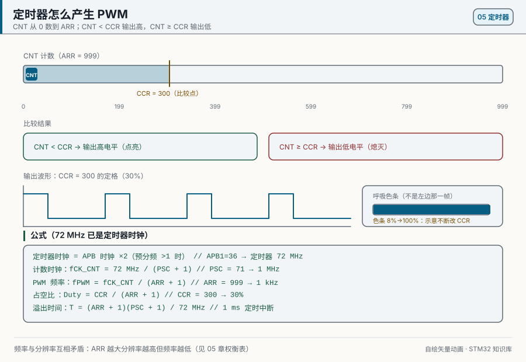

# timer-pwm —— TIM3 PWM 呼吸灯

> 难度：★★☆☆　｜　涉及外设：TIM（PWM）　｜　对应章节：[ch12 定时器与PWM](../../docs/v1-drivers/12-timers-pwm.md)

<p align="center">
  
  <br><sub>▲ 动画：定时器计数、比较匹配与 PWM 占空比（呼吸灯，作者自绘矢量图）</sub>
</p>

> 验证边界：本目录是 BluePill/STM32F103C8T6 的完整 HAL + CMake 工程。宿主回归 1/1 通过，ARM ELF/BIN 向量与内存检查通过；**未上板，未用示波器或逻辑分析仪测量**。F407 主样板及安全/取证见 [PWM协议](../../labs/timer-pwm/README.md)，不混用时钟/复用。

## 一、功能说明

用 TIM3 的通道 1（PA6）输出 **1kHz PWM**，在主循环里线性改变比较值 CCR（0 ↔ ARR 往返），
让接在 PA6 的 LED 呈现**呼吸**效果。示例同时给出频率/占空比公式，以及高级定时器 TIM1 的 MOE 说明。

`oc.Pulse = PWM_ARR / 2U` 给出启动初值 CCR=499（49.9%）；进入主循环后第一次写入 10，随后按步长 10 往返。CCR 的完整范围是 0–999，对应占空比 0–99.9%，不是 0–100%。

## 二、硬件接线表

| 开发板 | 外设 | 引脚 | 接法 | 备注 |
| --- | --- | --- | --- | --- |
| BluePill | LED（PWM 调光） | PA6 (TIM3_CH1) | PA6 → 270Ω → LED 阳极，阴极 → GND | 高电平点亮，占空比越大越亮 |

> 用示波器/逻辑分析仪接 PA6，可看到 1kHz 方波，高电平宽度随 CCR 变化。

## 三、CubeMX 关键配置

| 配置项 | 取值 | 说明 |
| --- | --- | --- |
| TIM3 → Clock Source | Internal Clock | 内部时钟 |
| TIM3 → Channel1 | PWM Generation CH1 | 复用为 PWM 输出 |
| TIM3 → Prescaler | 71 | 72MHz/(71+1)=1MHz |
| TIM3 → Counter Period (ARR) | 999 | 1MHz/(999+1)=1kHz |
| TIM3 → Pulse (CCR) | main.c 写 `PWM_ARR / 2U` = 499 | 启动初值 49.9%；主循环随后从 0 开始扫描 |
| TIM3 → PWM Mode | PWM mode 1 | CNT<CCR 输出有效 |
| GPIO PA6 | AF Push Pull / High speed | 复用推挽 |

本工程的 HAL 配置同时启用 DMA 模块。F1 的 `TIM_HandleTypeDef` 内含 `DMA_HandleTypeDef *hdma[7]`，即使只做 PWM，关闭 DMA 模块也会让 TIM 头文件找不到该类型；ST 官方 `TIM_PWMOutput` 例程同样启用 `HAL_DMA_MODULE_ENABLED`。

## 四、关键代码解读

**1) 频率与占空比公式**

```text
fCK_CNT = fCK_PSC / (PSC + 1)                      计数时钟
f_PWM   = fCK_PSC / ((ARR + 1) × (PSC + 1))        PWM 频率
Duty    = CCR / (ARR + 1) × 100%                   占空比
```

本例：`PSC=71 → fCK_CNT=1MHz`，`ARR=999 → f_PWM=1kHz`；CCR=0–999 对应占空比 0–99.9%。

**2) 时基 + 通道配置**

```c
htim3.Init.Prescaler         = PWM_PSC;   /* 71  */
htim3.Init.Period            = PWM_ARR;   /* 999 = ARR */
htim3.Init.AutoReloadPreload = TIM_AUTORELOAD_PRELOAD_ENABLE;
HAL_TIM_PWM_Init(&htim3);

TIM_OC_InitTypeDef oc = {0};
oc.OCMode     = TIM_OCMODE_PWM1;          /* PWM 模式 1 */
oc.Pulse      = PWM_ARR / 2U;             /* 启动初值 CCR = 499 → 49.9% */
oc.OCPolarity = TIM_OCPOLARITY_HIGH;
HAL_TIM_PWM_ConfigChannel(&htim3, &oc, PWM_CH);
HAL_TIM_PWM_Start(&htim3, PWM_CH);        /* 启动输出 */
```

> `AutoReloadPreload` 控制 ARR 预装载；CCR 预装载由 `HAL_TIM_PWM_ConfigChannel()` 设置 CH1 的 `OC1PE`。`HAL_TIM_PWM_Start()` 只负责使能通道；TIM1/TIM8 还会额外置 `BDTR.MOE`。不能因为 ARR 预装载已开就宣称 CCR 无毛刺。

**3) 动态改占空比（呼吸灯核心）**

```c
duty += step;
if (duty > (int16_t)PWM_ARR)
{
    duty = (int16_t)PWM_ARR;              /* 端点钳位，不写 ARR+1 */
    step = -step;
}
else if (duty < 0)
{
    duty = 0;
    step = -step;
}
__HAL_TIM_SET_COMPARE(&htim3, PWM_CH, (uint32_t)duty);
HAL_Delay(BREATH_DELAY_MS);
```

序列为 `10…990, 999, 989…9, 0`，不会把 1000 写进 CCR。

**4) 高级定时器 TIM1 的 MOE**

```c
HAL_TIM_PWM_Start(&htim1, TIM_CHANNEL_1);   /* HAL 内部置 MOE */
/* 寄存器写法：__HAL_TIM_MOE_ENABLE(&htim1);  // TIM1->BDTR |= TIM_BDTR_MOE */
```

TIM1/TIM8 若不开 MOE，通道使能了也没有波形输出，是最常见的「高级定时器没波形」原因。

## 五、编译与检查

### 依赖

- STM32CubeF1 `v1.8.6`，包含 HAL 与 CMSIS device 子模块；固定提交见 [`dependencies.lock.json`](dependencies.lock.json)。
- `arm-none-eabi-gcc`、CMake ≥ 3.21、Ninja、Python 3（运行固件检查）。
- 不需要把 vendor 源码复制进本目录；CMake 通过 `CUBEF1_PATH` 指向 CubeF1 checkout。

### 宿主回归

```bash
cd examples/timer-pwm
cmake --preset host-tests
cmake --build --preset host-tests
ctest --preset host-tests
```

本轮本机结果：`1/1 Test #1: timer-pwm-host ... Passed`。测试 include 真实的 `main.c`，用模拟 HAL 和 `setjmp` 有界运行，覆盖时钟/引脚、TIM3 时基/通道、220 次 CCR 写入及初始化失败路径。

### BluePill 固件

```bash
cmake --preset bluepill -DCUBEF1_PATH=/path/to/STM32CubeF1
cmake --build --preset bluepill
python tests/check_firmware.py build/bluepill/timer-pwm.elf build/bluepill/timer-pwm.bin
```

输出在 `build/bluepill/`：`timer-pwm.elf`、`.hex`、`.bin`、`.map` 和 `licenses/`。检查脚本核对复位/SysTick 向量、向量表基址、FLASH 上限、`htim3` 的 `.bss` 位置和至少 2KiB 栈预留。

本轮本机结果：

- FLASH：6496 B / 64KiB。
- 链接器 `size`：`text=6484`、`data=12`、`bss=2124`，合计 RAM 2136 B；其中 2048 B 是栈预留，检查脚本按 `_ebss` 计算的静态 RAM 为 88 B。
- 检查输出：`PASS: 6496 Flash bytes; SP=0x20005000; reset=0x8000325; SysTick=0x800030d; htim3=0x2000000c+72 B; RAM=88 B; >=2 KiB stack reserved`。
- BIN SHA-256：`bc10f40f65cb80ff7bf061312b36e9764c226e0ba1f4761dd2868ad36aad6287`。ELF 会嵌入构建路径，哈希不作为跨目录常量。

这些结果只证明工程可构建、向量表和内存布局符合检查，不证明 PA6 已经输出波形。

### Wokwi

`wokwi.toml` 指向 `build/bluepill/timer-pwm.elf`。先完成上面的 BluePill 构建，再启动 Wokwi；仿真结果不能替代实板测量。

## 六、预期现象（理论设计，未实测）

- 接 PA6 的 LED 由暗到亮、再由亮到暗循环（呼吸灯）。
- 示波器测 PA6：频率稳定在 **1kHz**，占空比在 0–99.9% 之间变化。
- 一个完整往返约 200 次 CCR 写入 × 10ms = 2.0 秒；端点为 `10…990, 999, 989…9, 0`。

以上均为按公式和代码推导的预期，不是板上读数。

## 七、常见问题

| 现象 | 原因 | 解决 |
| --- | --- | --- |
| 本例PA6无波形 | TIM3通道/时钟/复用未放行 | 查TIM3 CC1E/CEN和GPIO；TIM3没有MOE，高级TIM的MOE不适用于本例 |
| LED 一直亮/灭 | 占空比固定在 0 或 ARR | 检查 CCR 是否在 0–ARR 间变化 |
| 频率不对 | PSC/ARR 算错或时钟树不对 | 用公式重算，确认定时器时钟 |
| 调占空比时闪一下 | CCR 预装载未生效 | 确认 `HAL_TIM_PWM_ConfigChannel()` 设置了 CH1 的 `OC1PE`；ARR 预装载不是 CCR 预装载 |
| 波形抖动有毛刺 | GPIO 速度太低 | 复用输出设 `GPIO_SPEED_FREQ_HIGH` |
| 编译报 `DMA_HandleTypeDef` 未定义 | HAL 配置未启用 DMA 模块 | 按 ST `TIM_PWMOutput` 例程启用 `HAL_DMA_MODULE_ENABLED`，并加入 `stm32f1xx_hal_dma.c` |
| 亮度不线性 | LED 人眼非线性 | 用伽马校正或查表调光 |

## 八、相关资源

- 参考手册 **RM0008** 第 14 章（TIM 通用/高级定时器，含 CCMR/CCER/BDTR）
- 数据手册 **DS5319** 引脚复用表（TIM3_CH1 = PA6）
- ST 官方 CubeF1 PWM 例程：[`TIM_PWMOutput`](https://github.com/STMicroelectronics/STM32CubeF1/tree/v1.8.6/Projects/STM3210E_EVAL/Examples/TIM/TIM_PWMOutput)（HAL 初始化顺序与模块选择参考）
- 相关图：[`assets/animations/timer-modes.svg`](../../assets/animations/timer-modes.svg)、[`assets/gif/pwm-breath.gif`](../../assets/gif/pwm-breath.gif)
- 免责声明：本示例配图为作者自绘矢量图/程序生成动画，非厂商实拍照片。
