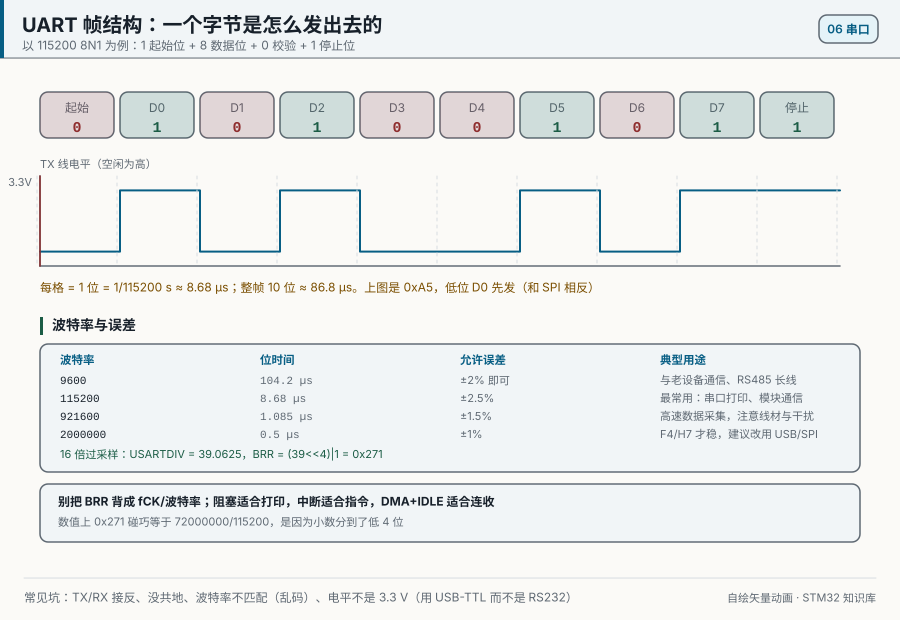

# uart-dma-idle —— UART + DMA + IDLE 不定长接收

> 难度：★★★☆　｜　涉及外设：USART + DMA + 环形缓冲　｜　对应章节：[第13章UART](../../docs/v1-drivers/13-uart-framed-protocol.md) / [第14章DMA](../../docs/v1-drivers/14-dma.md)

<p align="center">
  
  <br><sub>▲ 动画：UART 帧结构逐位时序（起始位/数据位/校验/停止位，作者自绘矢量图）</sub>
</p>

本目录提供 **BluePill / STM32F103C8T6 的完整 CMake 工程**：固定 STM32CubeF1 `v1.8.6`、HAL/CMSIS 子模块提交、启动文件、64 KiB Flash / 20 KiB RAM 链接脚本、SysTick 时基、USART1 + DMA1 Channel5 中断入口和许可复制。固件构建、向量/内存检查与宿主回归测试均通过；下载、串口收发、波形和吞吐仍待实测。

`hardware_status: pending`。宿主测试使用受控 HAL 替身，覆盖 HT→IDLE/TC 前缀不重复、重装失败、环形缓冲、命令解析、初始化与启动路径；它不证明真实 HAL 时序或板上行为。

## 一、功能说明

用 USART1 的 **DMA + IDLE 空闲中断**实现不定长接收，收到的数据进入**软件环形缓冲区**，主循环异步取出并做**命令行解析**（AT 指令风格）。相比「`HAL_UART_Receive` 定长接收」，DMA 搬到 64 字节接收区，ISR 再复制到软件环；不是零拷贝。IDLE 只是线路空闲交付事件，不是应用帧边界，命令行仍靠 CR/LF 组帧。

支持的命令：

| 指令 | 作用 | 返回 |
| --- | --- | --- |
| `AT` | 握手 | `OK` |
| `AT+LED=0/1` | 设置板载 LED（0 点亮） | `OK` |
| `AT+LED?` | 查询 LED 状态 | `+LED:<0/1>` |
| `AT+ECHO=0/1` | 开/关回显 | `OK` |
| `AT+INFO` | 固件信息 | 版本串 |
| `AT+RESET` | 软件复位 | `OK` |

## 二、硬件接线表

| 开发板 | 外设 | 引脚 | 接法 | 备注 |
| --- | --- | --- | --- | --- |
| BluePill | USB-TTL 模块 | PA9 (TX) → 模块 RX | 交叉连接 | USART1_TX |
| BluePill | USB-TTL 模块 | PA10 (RX) ← 模块 TX | 交叉连接 | USART1_RX |
| BluePill | 共地 | GND ↔ GND | **必须共地** | 否则乱码 |
| BluePill | LED | PC13 | 板上已接 | 低电平点亮 |

> USB-TTL 模块选 3.3V 电平（如 CH340/CP2102 的 3V3 档），避免 5V 直连 IO。

## 三、固定板型与时钟

| 配置项 | 取值 | 说明 |
| --- | --- | --- |
| USART1 → Mode | Asynchronous | 异步串口 |
| USART1 → Baud Rate | 115200 | 8-N-1 |
| USART1 → DMA | USART1_RX → DMA1 Channel5, Normal | RX 用 DMA；HT 不终止普通模式接收 |
| NVIC | USART1 global interrupt = ✔ | IDLE 中断靠它 |
| NVIC | DMA1 Channel5 global interrupt = ✔ | 传输完成/错误 |
| 时钟 | HSE 8MHz → PLL ×9 → 72MHz | APB1=36MHz，APB2=72MHz |
| SYS → Debug | Serial Wire | 保留 PA13/PA14 SWD |

> F1 的 DMA 请求映射固定：**USART1_RX = DMA1_CH5，USART1_TX = DMA1_CH4**（见 RM0008 表 78）。72MHz 需 `FLASH_LATENCY_2`。

## 四、关键代码解读

**1) 启动「DMA + 空闲」接收**

```c
/* DMA_NORMAL；首次与后续重装都检查返回值。 */
if (HAL_UARTEx_ReceiveToIdle_DMA(&huart1, g_dma_rx_buf, DMA_RX_BUF_SIZE) != HAL_OK) {
    error_handler();
}
```

**2) 接收事件回调（IDLE / 半满 / 满都会进这里）**

```c
void HAL_UARTEx_RxEventCallback(UART_HandleTypeDef *huart, uint16_t Size)
{
    if (huart->Instance == UART_INSTANCE)
    {
        /* DMA_NORMAL: HT只报进度，接收仍活动；等IDLE/TC后复制整个前缀一次。
         * 官方F1 HAL_UARTEx_GetRxEventType说明普通模式HT不终止接收。 */
        if (HAL_UARTEx_GetRxEventType(huart) == HAL_UART_RXEVENT_HT)
        {
            return;
        }
        rb_push(&g_rb, g_dma_rx_buf, Size);
        /* 重新武装：下一次不定长接收 */
        if (HAL_UARTEx_ReceiveToIdle_DMA(huart, g_dma_rx_buf, DMA_RX_BUF_SIZE) != HAL_OK)
        {
            error_handler(); /* 明确停机；不把重装失败当作已恢复接收。 */
        }
    }
}
```

DMA_NORMAL 中 HT 的 `Size=32` 只是进度，不消费/重装；IDLE 或 TC 终止时再复制当前传输的 `Size` 字节一次。`Size` 不等于协议一帧，64 字节 TC 也可能只是长命令的一段。重装 `HAL_ERROR/HAL_BUSY` 会进入既有 `error_handler` 明确停机，不是已保证恢复；错误回调也检查重装返回。

**3) 环形缓冲区（生产者=ISR，消费者=主循环）**

```c
static void rb_push(ring_buf_t *rb, const uint8_t *d, uint16_t len) {
    for (uint16_t i = 0; i < len; i++) {
        uint16_t next = (rb->head + 1) & (RING_BUF_SIZE - 1);
        if (next == rb->tail) break;      /* 满则丢 */
        rb->buf[rb->head] = d[i];
        rb->head = next;
    }
}
```

用 2 的幂大小 + 位与取模，`head/tail` 都是 `volatile`，适配「单生产者单消费者」模型。当前实现满则丢弃多余数据，没有溢出计数；需要无损或可诊断路径时先补计数与恢复策略，不把“有环形缓冲”当作“不丢数据”。

**4) 命令行解析（逐字节组帧，遇到 CR/LF 执行）**

```c
static void cmd_process_char(char c) {
    if (c == '\r' || c == '\n') {
        if (g_line_len) { g_line[g_line_len] = '\0'; cmd_execute(g_line); g_line_len = 0; }
        return;
    }
    if (g_line_len < CMD_LINE_MAX - 1) g_line[g_line_len++] = c;
}
```

## 五、编译、检查与烧录

先让编译产物出现，再接下载器。需 Git、CMake ≥3.21、Ninja、GNU Arm 工具链（含 newlib）；下载另需 OpenOCD。本机验证版本为 GCC 10.3.1、CMake 3.30.2、Ninja 1.12.1；其他环境以实际日志为准。

以下从**仓库根目录**执行，PowerShell / bash 均可。首次下载依赖需要网络；已有相同提交的 CubeF1 可直接传其路径，不重复 clone：

```console
git clone --depth 1 --branch v1.8.6 https://github.com/STMicroelectronics/STM32CubeF1.git .temp/STM32CubeF1
git -C .temp/STM32CubeF1 submodule update --init Drivers/STM32F1xx_HAL_Driver Drivers/CMSIS/Device/ST/STM32F1xx
cd examples/uart-dma-idle
cmake --preset bluepill "-DCUBEF1_PATH=../../.temp/STM32CubeF1"
cmake --build --preset bluepill
python tests/check_firmware.py build/bluepill/uart-dma-idle.elf build/bluepill/uart-dma-idle.bin
```

`build/bluepill/` 中应有 `uart-dma-idle.elf/.hex/.bin/.map`。最后一条检查实际二进制的栈顶、复位入口、SysTick、DMA1 Channel5、USART1 向量、DMA 缓冲区地址和容量边界。提交不匹配或漏初始化子模块时，CMake 停止并打印预期提交。构建同时把 HAL、CMSIS device 与 CMSIS core 的原始许可复制到 `build/bluepill/licenses/`。

2026-11-25 本机快照：BIN 14,400 B，SHA-256 `c61137e31021a4e7b0982691f76eb7640fa4277ec804576a34d3e58564da64a3`；Flash 14,400 B / 64 KiB，RAM 3,040 B / 20 KiB，保留至少 2 KiB 栈。换工具链后以新日志和哈希为准。

用原生 C 编译器运行回归测试（不连接硬件）：

```console
cmake --preset host-tests
cmake --build --preset host-tests
ctest --preset host-tests
```

测试覆盖：环形缓冲回绕/满、AT 命令与超长行、HT 不重装、IDLE/TC 前缀交付与重装、重装/错误/初始化/时钟切换/首次接收失败停机、UART/DMA/NVIC 初始化、72MHz 时钟、启动行与 SysTick。模拟 HAL 只验证这些程序分支；真实 HAL 和启动文件由 ARM 构建与向量检查核对。

编译成功后，核对 BOOT0=0、PA13/SWDIO、PA14/SWCLK、GND 和目标供电，再执行下载。在本例程目录运行：

```console
openocd -f interface/stlink.cfg -f target/stm32f1x.cfg -c "program build/bluepill/uart-dma-idle.elf verify reset exit"
```

保存包含 `verify` 成功的完整日志；复位后再记录串口现象。此下载命令在本轮未执行。接入已有 CubeIDE 工程时，采用第三节配置并保留同一时基，避免重复定义 `main`、`SystemClock_Config`、`SysTick_Handler`、`USART1_IRQHandler` 或 `DMA1_Channel5_IRQHandler`；本目录不提供 IDE 项目文件。

Wokwi 配置已指向 `build/bluepill/uart-dma-idle.elf`。Wokwi/主机测试都不代替真板串口、DMA 和仪器证据。

## 六、预期现象（理论与设计目标，未实测）

- 上电串口打印 `[BOOT] uart-dma-idle ready. type 'AT' for help`；
- 输入 `AT` → 回显 `> AT` + `OK`；
- 输入 `AT+LED=0` → 板载 LED 点亮；`AT+LED?` → 返回 `+LED:0`；
- 连续发送仍可能在普通模式重装窗口或软件环满时丢字节；需原始序列与计数实测，不能由环形缓冲存在就保证不丢。

## 七、常见问题

| 现象 | 原因 | 解决 |
| --- | --- | --- |
| 收到乱码 | 波特率/时钟不符或未共地 | 统一 115200，接 GND |
| 只收到一次就停 | 未重装或重装返回失败 | 查 HAL 返回与 `error_handler`；不要在普通模式 HT 事件重启活动 DMA |
| 一帧被拆成多帧 | 发送端字符间有空闲 | 缩短发送间隔，或按协议头尾组帧 |
| 丢数据 | 环形缓冲太小/溢出 | 先加溢出计数与原始字节比对，再调整缓冲或消费策略 |
| 中断进不去 | 没使能 USART1/DMA NVIC | `HAL_NVIC_EnableIRQ` 两处都要开 |
| 长命令截断/丢字节 | 重装窗口、软件环满或 `CMD_LINE_MAX` 边界 | 分别核 DMA 交付段与 CR/LF 组帧、长度及丢失，不能只加大 DMA 数组就保证无损 |
| 溢出错误后停机 | ORE/FE 或 DMA 重装失败 | 读取实际错误与重装返回；当前失败即明确停机，后续恢复策略需另行设计 |
| 构建提示提交不符 | 依赖版本错误或子模块未初始化 | 按第五节取固定 tag 和两个子模块，不跳过提交检查 |

## 八、相关资源与参考边界

- 参考手册 **RM0008** 第 27 章（USART）、第 13 章（DMA 请求映射表 78）。
- STM32CubeF1 `v1.8.6`，HAL 子模块 `77fbb30b7a1d02533980400083e48c559aae5a4f`；`HAL_UARTEx_ReceiveToIdle_DMA()` 与 `HAL_UARTEx_GetRxEventType()` 的语义以该版本源码为准。
- 《Mastering STM32》第二版物理第 269 页（印刷页 239）§9.4：局部/全局 DMA 缓冲区存储期；只作解释顺序参考，寄存器与 API 回到匹配版本的手册和源码。
- 野火《STM32 HAL 库开发实战指南》物理第 210 页：DMA 发送示例的“构建→下载→串口观察”闭环；其板型和接线不照搬到 BluePill。
- 相关图：[`assets/animations/uart-frame.svg`](../../assets/animations/uart-frame.svg)、[`assets/gif/uart-bits.gif`](../../assets/gif/uart-bits.gif)
- 免责声明：本示例配图为作者自绘矢量图/程序生成动画，非厂商实拍照片；本轮没有复制参考书插图。
