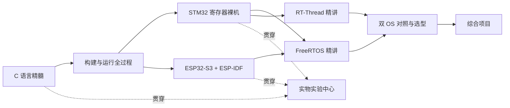

# 通往单片机之路 · 来源子树（`mcu/`）

> 本目录是《通往单片机之路》在 `zhuguang-ZFG/STM32` 仓库里的**来源子树**：保留示例工程、固件、Trellis 任务与 spec、视频制作工程、wiki 与仓库元信息。
>
> **书稿与站点已不在本目录。** B5 合并（2026-11-14）把原 `mcu/docs/`（VitePress 站）、`mcu/mcu-book/`（整书构建器）、`mcu/scripts/`、`mcu/tests/`、`mcu/package*.json`、`mcu/.github/workflows/mcu-*.yml` 整树退役，正文并入根书稿；现行书稿在根 `docs/`，构建在根 `book/`。记录见 [`plans/2026-11-12-merged-book/README.md`](../plans/2026-11-12-merged-book/README.md)（B5 结束状态）与本目录的 [P0 执行快照](../plans/2026-11-11-mcu-merge/research/execution-snapshot-2026-11-19.md)。

## 现在读什么、跑什么

| 想做的事 | 去哪 |
| --- | --- |
| 读现行书稿（原 MCU 各板块已并入） | 根 [`docs/`](../docs/README.md)；在线站 <https://zhuguang-zfg.github.io/STM32/> |
| 找旧 `/mcu/**` 地址 | 已改为跳转存根，自动落到合并后的对应页面（如 `/STM32/mcu/stm32/03-gpio.html` → `/STM32/v1-drivers/09-gpio.html`） |
| 看示例工程 | [`code/`](code/)（`code/projects.json` 登记工程清单） |
| 看 Trellis 规范与任务历史 | [`.trellis/spec/index.md`](.trellis/spec/index.md)、[`.trellis/workflow.md`](.trellis/workflow.md)、[`.trellis/tasks/`](.trellis/tasks/) |
| 看视频制作工程 | [`video/`](video/) |
| 看模块级技术 wiki | [`wiki/`](wiki/) |

**本目录没有 npm 工程。** `mcu/package.json` 已随书稿树退役：`npm run docs:dev`、`docs:build`、`anim:lint`、`readme:sync`、`book:html`、`book:pdf`、`quality`、`firmware:check`、`test:browser` 等命令在本目录不再可用，历史 README 里的这些命令只作记录。

固件与取证工程按各自目录说明执行；工作目录以该工程 README 为准（`code/` 下各工程自带构建说明，ESP32 侧用 ESP-IDF）。

## 书稿构建在哪里

| 交付 | 现行位置 | 命令（Git 根执行） |
| --- | --- | --- |
| 站点 | 根 `docs/` + `docs/.vitepress/` | `npm run docs:build` |
| 印刷 HTML / PDF / EPUB | 根 `book/` | `python -m book.build_html --check`、`make book-pdf`、`make book-epub` |

## 许可

[Apache-2.0](LICENSE)。本目录整体适用该许可，与外层仓库的双许可互不干涉。

---

以下为合并前的原始说明，保留作为历史记录。其中 `docs/`、`scripts/`、`mcu-book/`、`mcu-quality.yml`、`npm run …` 与 `/mcu/book/`、`/mcu/downloads/` 等路径**均已退役**，链接不再解析；只用于追溯当时的写作口径与进度统计。

## 历史：站点与书稿结构（已退役）

原结构：`docs/` 为 VitePress 站点（base `/mcu/`），`mcu-book/` 为整书离线版构建器（manifest：11 分部 / 94 章罗盘 / 75 项来源 + 七附录 + 契约测试），`scripts/` 为统计与动画自检，`.github/workflows/` 为 `deploy.yml` 与 `quality.yml` 两道闸门。动画为 `docs/public/anim/` 下的 SMIL 图，构建期内联进页面。

原标题、信条与定位不变：把一颗芯片讲透——寄存器级 STM32F407 × ESP32-S3 双路线、C 语言精髓、RTOS 双精讲、全程实物实验。

> [!WARNING]
> 这是学习材料，不是安全或选型依据；引脚、阈值、时序以芯片 datasheet 为准，没接仪器量过的现象一律标「待上板实测」。

### 历史：板块进度（合并前统计）

合并前记录：成稿 86 / 86 章（实物实验 8 篇另计），通读约 3310 分钟；实物实验 8 / 8 成稿（完整配套工程 7 项，上板验证 0 项）；机制动画 111 张；示例工程 47 个。这些数字对应**合并前**的 MCU 书稿，合并后以根书稿的 manifest 为准（`book/data/toc.tsv` → `docs/manifest.json`）。

### 历史：基准板卡

- 野火 STM32F407 霸天虎（F407ZGT6）——寄存器主线；RGB 红灯 PF6 / 绿 PF7 / 蓝 PF8
- 立创·实战派 ESP32-S3（小智板，N16R8）——ESP-IDF 主线
- GD32 双系（G 篇 GD32F4xx / V 篇 GD32VF103）

### 历史：学习路线



### 历史：合并前的自检命令（当前不可用）

```bash
npm install && npm run docs:build   # 站点（已退役）
npm run anim:lint                   # 动画规范闸门（已退役）
npm run readme:check                # 数字漂移检查（已退役）
npm run book:check && npm run book:pdf   # 整书契约与 A4 PDF（已退役）
npm run quality                     # 汇总质量门（已退役）
```

## 历史：常见问题（合并前口径）

**Q1 我没有开发板，能学什么？** 合并前的回答列出 B2 ELF 解剖、C1 内存模型、C3 volatile 等只用编译器与 `readelf`/`objdump` 的章节，取证脚本在 `code/toolchain/` 与 `code/c/`，`sh probe.sh` 一条命令跑完。这些工程仍在 [`code/`](code/)，章节正文已迁入根书稿。

**Q2 为什么很多章节是空的？** 原则是「能实测再写」，宁可标建设中也不预填结论。

**Q3 页面上的数字可信吗？** 合并前由 `npm run docs:gen` 扫文件产出；现行数字以根书稿 manifest 为准。

**Q4 动画怎么看？** 动画已随章节迁入根站点，例如 <https://zhuguang-zfg.github.io/STM32/>。

**Q5 发现写错了怎么办？** 提 [Issue](https://github.com/zhuguang-ZFG/STM32/issues) 或按 [CONTRIBUTING.md](CONTRIBUTING.md) 提 PR，注明文件与小节、原文、应为、依据。

## 历史：参与共建

- 先读 [CONTRIBUTING.md](CONTRIBUTING.md)（内容深度标准、四件套结构、风格契约）。
- 写章节、做动画的规范仍在 `.trellis/spec/docs-site/` 下，作为写作口径参考；构建与自检脚本已随树退役。
- 现行书稿的门在根 `book/`：`make book-check`、`npm run site:build`。

> AI生成