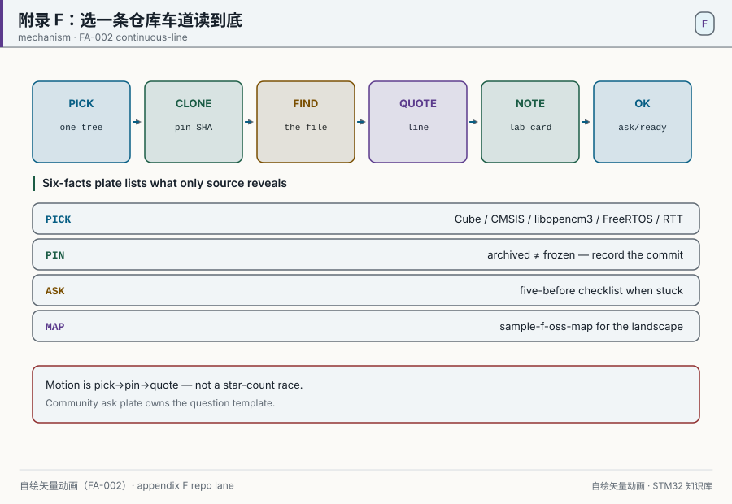
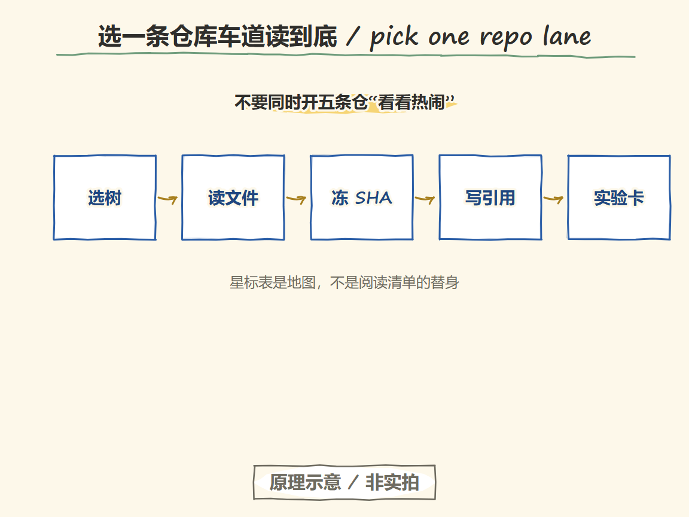
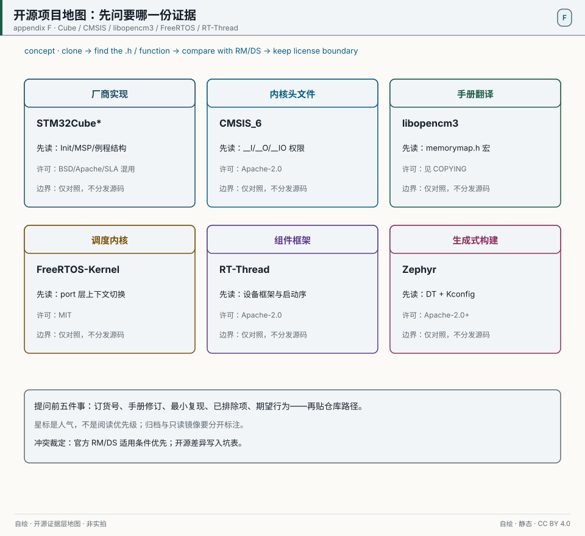
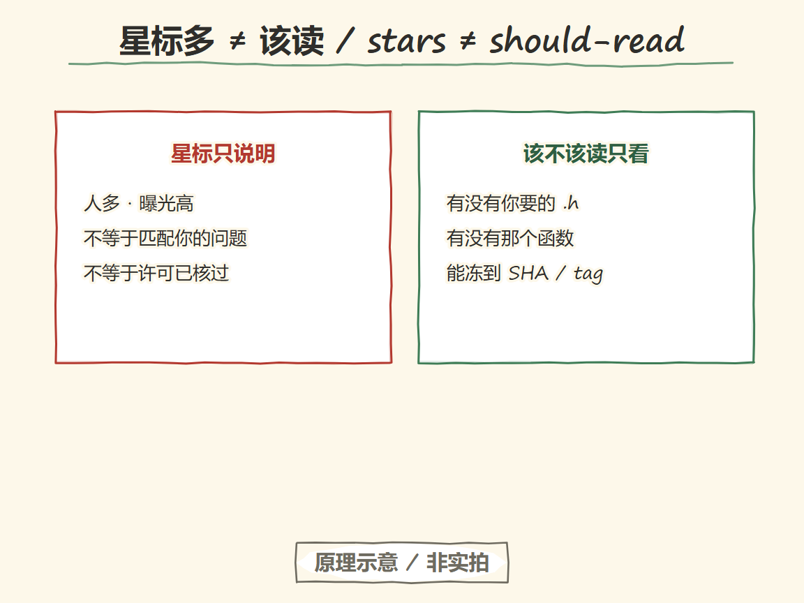
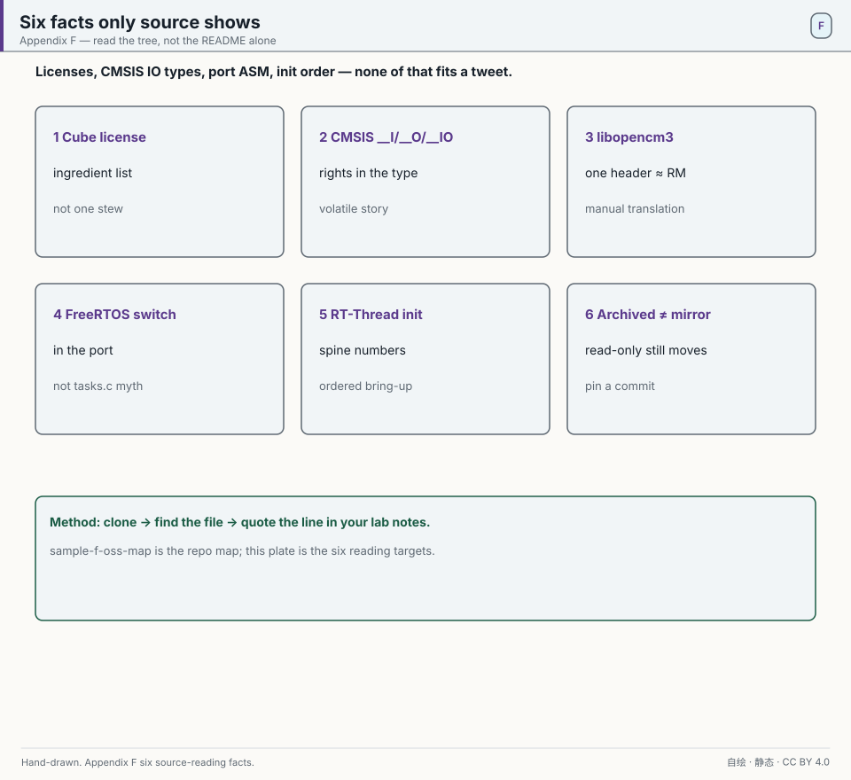
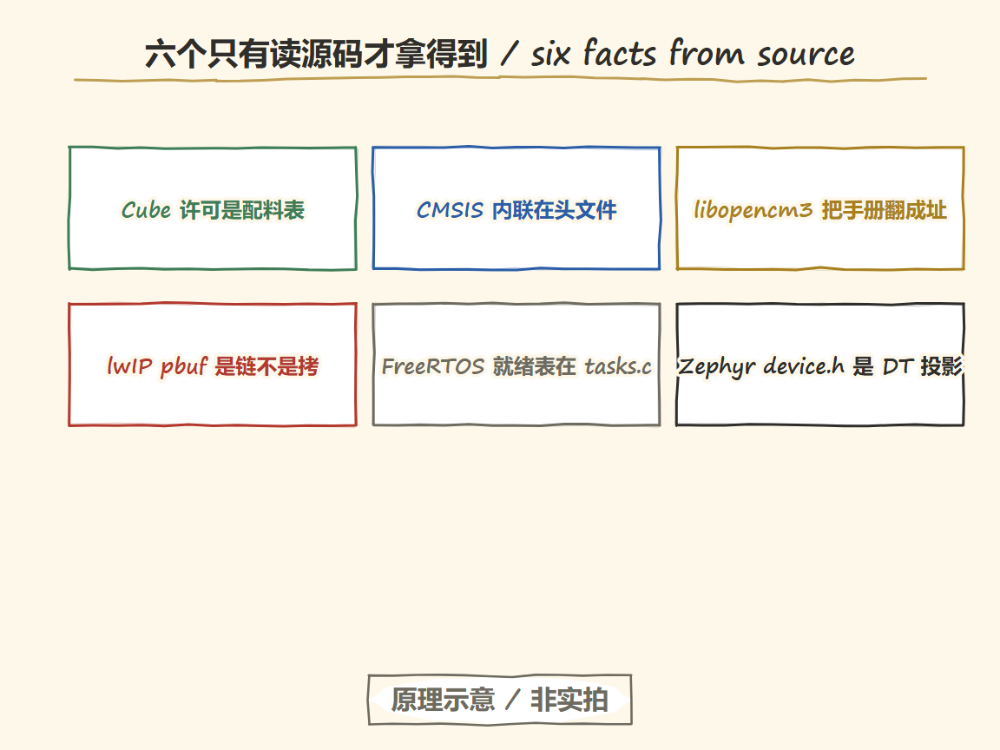
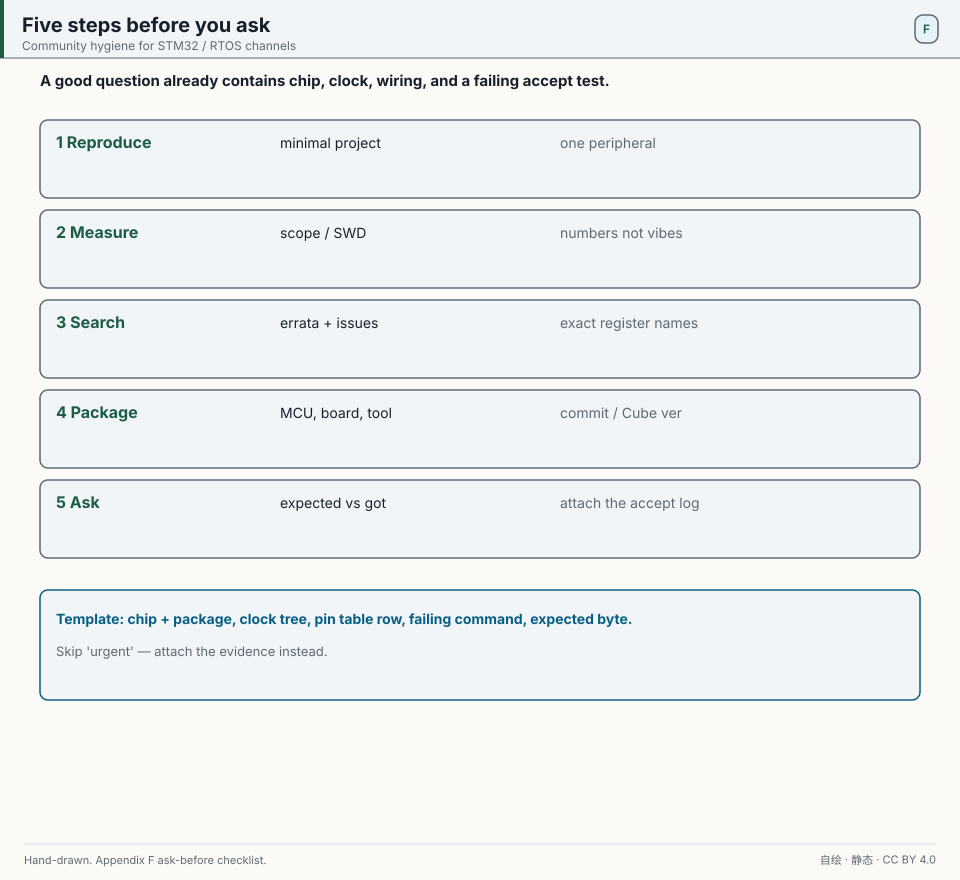
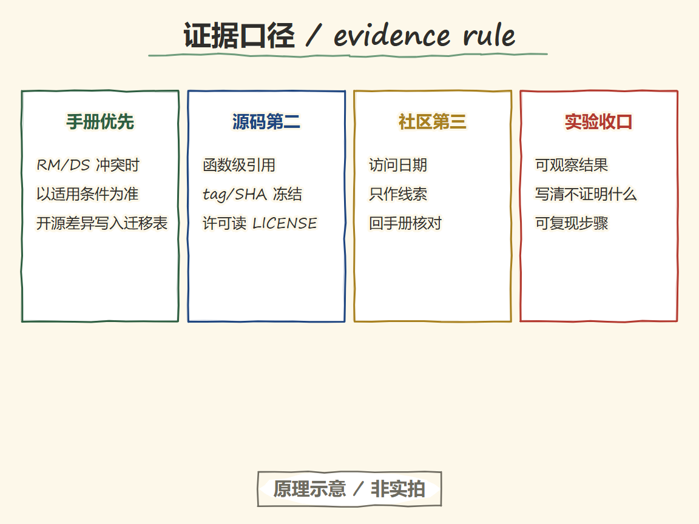

# Open-source project and community map

Every claim in this book must be traceable to a manual, source code, or a measurement. Open-source repositories are the cheapest layer of the third evidence tier: no license application, no NDA — after `git clone` you can see how the vendor and the community each implement the same thing.

This appendix gives three things: a chapter-organized repository map (star counts and archive status from the GitHub API on 2026-10-26; licenses from each repo-root `LICENSE`), six facts you only get by reading the source, and a minimum discipline for asking the community.

**Many stars means "many people", not "you should read it".** The only read-worthiness test is: does the tree contain the `.h` or the function you need?

## Repository map

  
   ▲ Hand-drawn CSS animation (FA-002). pick → pin SHA → quote → lab card.

  
   ▲ Knowledge track (Handraw · 原理示意 / not a photo). Pick the tree → read the file → freeze the SHA → cite → lab card. Not a photo.

  
   ▲ Drawn for this book. Open-source evidence-layer map: ask which `.h`/function you need before you talk about stars. License boundaries are in each repo `LICENSE`; when official RM/DS and OSS disagree, the manual's applicable conditions win.

  
   ▲ Knowledge track (Handraw · 原理示意 / not a photo). Read it only if the target .h or function is there. Not a photo.

| Ch | Repository | Stars | License | Read first |
|---|---|---|---|---|
| 01 Env | platformio/platformio-core | 9564 | see `LICENSE` | `platformio/builder/`: who decides `-mcpu` and the linker script |
| 03 GPIO | STMicroelectronics/STM32CubeF4 | 1361 | HAL/BSP/Projects = BSD-3-Clause; CMSIS/mbedTLS = Apache-2.0; USB/STemWin/TouchGFX = SLA0044 | `Drivers/STM32F4xx_HAL_Driver/Src/` — any peripheral `Init` |
| 03 GPIO | libopencm3/libopencm3 | 3671 | see `COPYING` | `include/libopencm3/stm32/f4/memorymap.h`: the manual turned into macros |
| 04 NVIC | ARM-software/CMSIS_6 | 483 | Apache-2.0 | `CMSIS/Core/Include/core_cm4.h`: `__I/__O/__IO` and NVIC inlines |
| 04 NVIC | STMicroelectronics/cmsis-device-f4 | 161 | Apache-2.0 (per Cube component table) | `Include/stm32f407xx.h`: register structs and bitfields |
| 12 Flash/IAP | openocd-org/openocd | 2365 | GPL-2.0 (see `COPYING`) | `src/flash/nor/stm32f2x.c`: how a Flash algorithm is written |
| 12 Flash/IAP | littlefs-project/littlefs | 6980 | BSD-3-Clause | `lfs.c` metadata pairs and wear leveling |
| 12 Flash/IAP | pellepl/spiffs | 1632 | MIT | `spiffs_nucleus.c` GC triggers and page state machine |
| 15 FreeRTOS | FreeRTOS/FreeRTOS-Kernel | 4609 | MIT | `tasks.c` ready lists; `portable/GCC/ARM_CM4F/port.c` PendSV switch |
| 19 Projects | grbl/grbl | 6309 | GPL-3.0 (see `COPYING`) | `stepper.c`: in the ISR, only "emit one pulse + bookkeeping" |
| 19 Projects | hathach/tinyusb | 7238 | MIT | `src/device/usbd.c` endpoints and descriptor assembly |
| 19 Projects | lvgl/lvgl | 25010 | MIT | `src/core/lv_obj.c` object tree, `src/draw/sw/` dirty rectangles |
| 20 Toolchain | pyocd/pyOCD | 1473 | see `LICENSE` | `pyocd/core/` target abstraction: debug protocol → API |
| 20 Toolchain | blackmagic-debug/blackmagic | 3719 | see `COPYING` | **Archived** (`archived: true`); read-only |
| 20 Toolchain | micropython/micropython | 22154 | see `LICENSE` | `ports/*/mpconfigport.h`: what a port must expose |
| 26 SPL | stm32duino/Arduino_Core_STM32 | 3375 | see `LICENSE` | Boundary between `system/Drivers/` and `cores/arduino/` |
| 27 Network | lwip-tcpip/lwip (GitHub mirror; upstream on savannah) | 1765 | BSD-3-Clause (SICS) | `src/core/pbuf.c` zero-copy chains, `tcp_in.c` state machine |
| 27 Network | apache/mynewt-nimble | 895 | Apache-2.0 | `nimble/host/src/ble_gap.c` connection state machine |
| 28 RTOS ecosystem | RT-Thread/rt-thread | 12309 | Apache-2.0 | `src/object.c` object container, `src/components.c` init levels |
| 28 RTOS ecosystem | zephyrproject-rtos/zephyr | 16906 | see `LICENSE` | `include/zephyr/device.h`: device-tree at runtime |
| 28 RTOS ecosystem | apache/nuttx | 4087 | Apache-2.0 | `sched/` task model, `drivers/` layered registration |
| 28 RTOS ecosystem | RIOT-OS/RIOT | 5827 | LGPL-2.1 | `core/sched.c` minimal scheduler, `sys/` abstraction |
| 28 RTOS ecosystem | espressif/esp-idf | 19347 | Apache-2.0 | `components/esp_common/include/esp_err.h` |

## Six facts you only get by reading the source

  
   ▲ Drawn for this book. Star counts do not replace these six facts.

  
   ▲ Knowledge track (Handraw · 原理示意 / not a photo). License mix, CMSIS inlines, pbuf chains, ready lists — only source gives them. Not a photo.

### 1. Cube's license is an ingredient list, not one stew

**Principle:** The whole SDK is not one cooked stew; it is an ingredient list — each ingredient has its own terms.

**Mechanism:** `STM32CubeF4/LICENSE.md` is itself a table: STM32F4 HAL, all BSP, FatFS, LwIP, Utilities, basic Examples = BSD-3-Clause; CMSIS, CMSIS Device, mbedTLS = Apache-2.0; USB library, STemWin, TouchGFX, STM32_Audio = SLA0044 (ST proprietary); LibJPEG = Independent JPEG Group License.

**Field pitfall:** "Cube is BSD" is true only for HAL/BSP. Link the USB library or TouchGFX into a product and the obligations change; treating SLA0044 as BSD fails a compliance review.

### 2. CMSIS `__I/__O/__IO` encode read/write rights in the type

**Principle:** These are not comments; they are type-level wrappers around `volatile` — the compiler decides from the type whether an access may be optimized away.

**Mechanism:** Three lines in `CMSIS/Core/Include/core_cm4.h`: `__I` = `volatile const` (read-only), `__O` = `volatile` (write-only), `__IO` = `volatile` (read/write). Every register-struct member carries one of them, so a read of `GPIOA->ODR` is not optimized away and a write is not lied about either.

The same file's `__NVIC_SetPriority()` answers another common question: the value written to `IPR` is `priority << (8 - __NVIC_PRIO_BITS)` — **the priority is shifted left because the upper 4 bits of the register are the ones that count**, and `__NVIC_PRIO_BITS` comes from the device header (4 on F407). You think you write 0..15; you actually write the upper nibble.

### 3. libopencm3's "manual translation" is a single header

**Principle:** One reference-manual section, turned line by line into `#define`s and structs — reading it is reading a compilable digest of the manual.

**Mechanism:** `include/libopencm3/stm32/f4/memorymap.h` (7755 B) holds base-address macros for each peripheral; sibling `gpio.h` / `rcc.h` in the same directory are only a few hundred to a few thousand bytes of declarations. **There is no `memorymap/` directory** — an early draft assumed a directory and was corrected by the real tree.

**How to read:** `memorymap.h` for bases, then `common/*.h` for bit definitions, then `lib/stm32/common/*.c` for usage. When register values disagree with the applicable RM/DS conditions, the manual wins; libopencm3 is a translation aid, not a substitute for the manual.

### 4. FreeRTOS context switch lives in the port, not in `tasks.c`

**Principle:** The kernel only decides *who* switches; the chip-specific port moves the registers.

**Mechanism:** In `portable/GCC/ARM_CM4F/port.c` (41,783 B), `xPortPendSVHandler` saves `r4-r11` onto the current task stack, writes PSP back into the TCB, calls `vTaskSwitchContext()` to select the next `pxCurrentTCB`, then restores from the new TCB. That is why "task-switch cost" is counted from the port assembly, not from the C in `tasks.c`.

**Corollary:** Bumping the kernel version while leaving the port alone leaves switch cost essentially unchanged; changing the core (M3 → M4F) requires a recount — FPU context is an extra layer.

### 5. RT-Thread init is "shelved by spine number"

**Principle:** The linker is a librarian that sorts by the number on the spine, not by the order you carried books into the building.

**Mechanism:** `INIT_EXPORT(fn, "level")` drops a function pointer into a linker section named by a string; at link time sections are concatenated in dictionary order into a contiguous array, and startup walks from the head to the tail. `src/components.c` has `INIT_EXPORT(rti_start, "0")` and `INIT_EXPORT(rti_board_start, "0.end")`; `bsp/tm4c129x/applications/board.c` uses `"0.post"` so `rt_hw_cpu_init` runs before board init.

**Field pitfall:** Treating the six `INIT_*_EXPORT` macros as "levels 1–6" mis-orders device registration vs scheduler start. Levels are strings: `"0" < "0.end" < "0.post" < "1"`.

### 6. "Archived" and "read-only mirror" are not the same thing

**Principle:** One means "the door plate is still up, nobody is home"; the other means "this room holds a photocopy; the original is elsewhere".

**Mechanism:** `openocd-org/openocd` describes itself as "Official OpenOCD Read-Only Mirror (no pull requests)" — the repo is alive, but this GitHub side takes no PRs. `ARM-software/CMSIS_5` and `blackmagic-debug/blackmagic` have `archived: true`: read-only, no further changes; CMSIS continues in CMSIS_6.

**Field pitfall:** Opening a PR on a mirror and waiting a month; waiting for a new release on an archived repo and getting only "no longer maintained".

## Community: five things before you ask

  
   ▲ Drawn for this book. A question template before an emotional post.

  
   ▲ Knowledge track (Handraw · 原理示意 / not a photo). README, frozen commit, minimal repro, raw logs, paths already ruled out. Not a photo.

1. **Read the issue template.** What the template asks for is what the maintainers need most.
2. **Shrink the repro to the minimum.** Prefer 20 lines over 200; delete every init you can until the step just before the symptom disappears.
3. **Version triple:** chip orderable, Cube firmware pack / kernel tag, compiler version. Missing one forces the answer to guess.
4. **Evidence, not adjectives.** "Doesn't work" carries no information; `nm`/`objdump` snippets, UART logs, scope captures, and register dumps do.
5. **Search before you open.** Duplicate issues are the fastest way to be ignored.

## Practice list: six small projects you can finish in a week

| Repository | Read here | Skill practiced |
|---|---|---|
| libopencm3 | `stm32/f4/memorymap.h` + `common/gpio_common.h` | Documenting registers |
| STM32CubeF4 | `Drivers/STM32F4xx_HAL_Driver/Src/*_hal_gpio.c` | How a library wraps registers |
| FreeRTOS-Kernel | `portable/GCC/ARM_CM4F/port.c` | Minimal context switch |
| grbl (GPL-3.0) | `stepper.c` | Do the least possible in the ISR; **reading is fine, copying into closed-source firmware is not** |
| RT-Thread | `src/object.c` | Inheritance in C |
| pyOCD | `pyocd/core/` | Turning a protocol into an API |

## Evidence policy

  
   ▲ Knowledge track (Handraw · 原理示意 / not a photo). Manuals first, source second, community third, lab closes the loop. Not a photo.

- Star counts and the `archived` field: GitHub API, 2026-10-26.
- Licenses: repo-root `LICENSE` / `COPYING` / `LICENSE.md` text; STM32CubeF4 cited from its per-component table.
- Code paths: hits on the default branch that day; paths may drift — run `git log -1` before you read.
- This appendix cites no fact that is absent from the sources above.
